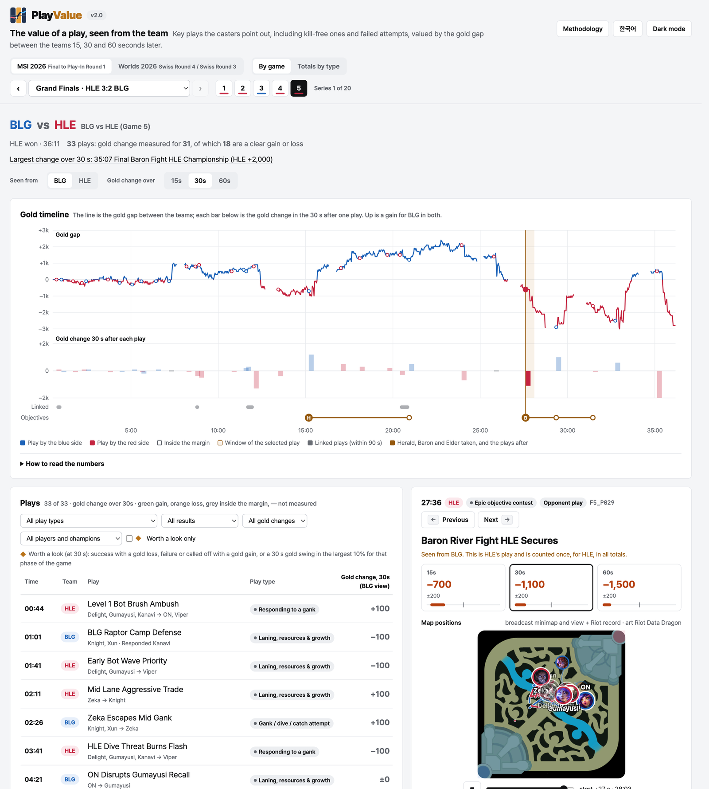

# PlayValue

**https://playvalue.github.io**

PlayValue looks at the plays that League of Legends casters call out in professional matches and shows how the gold gap between the two teams moved in the 15, 30 and 60 seconds after each one.

- Plays are picked from the commentary first, without looking at gold.
- The gold gap is then read off the broadcast, once a second.
- Each play is coded (what kind of play, who made it, which objective it led to) by three independent language-model coders and settled by majority vote, with an adjudicator where they split.

The number is what the team went through in that window, everything else on the map included. It is not the share of one play. The [methodology page](https://playvalue.github.io/methodology.html) sets out the procedure, the checks and the limits.

## What is here

This repository is the published site. It is built from a separate research repository and deployed here; changes made here directly are overwritten on the next deploy.

| Path | What it is |
|---|---|
| `index.html` | The dashboard: per-game view and totals by play type |
| `methodology.html` | How plays are picked, measured and coded (Korean and English) |
| `data/index.json` | Tournaments, games and site-wide counts |
| `data/<tournament>/plays.json` | Plays of every game in a tournament |
| `data/<tournament>/games/<game>.json` | One game: teams, roster, gold timeline, plays, map positions |
| `assets/ddragon/` | Map and champion images from Riot's Data Dragon |

Tournaments covered so far: MSI 2026 (all 71 games) and Worlds 2026 (added as series finish). As of 31 October 2026 the site holds 86 games and 4,280 plays.

## Questions and data

Questions, corrections and offers of finer match data for research (per-second events, player positions) are welcome as [issues](https://github.com/playvalue/playvalue.github.io/issues).

PlayValue is part of a wider line of research on games and esports data, for example [When the Rule-Maker Runs the World Championship](https://arxiv.org/abs/2610.07427) (Haewoon Kwak, 2026).

## 한국어

PlayValue는 프로 경기에서 해설이 짚은 플레이마다, 그 뒤 15·30·60초 동안 두 팀의 골드 차가 어떻게 움직였는지 보여 줍니다. 플레이는 골드를 보지 않고 해설에서 먼저 고르고, 골드는 방송 화면에서 1초마다 읽습니다. 자세한 방법과 한계는 [방법론 페이지](https://playvalue.github.io/methodology.html)에 있습니다. 질문이나 데이터 협력 제안은 [Issues](https://github.com/playvalue/playvalue.github.io/issues)에 남겨 주세요.

## Notes

Visits are counted with [Umami](https://umami.is) without cookies.

PlayValue isn't endorsed by Riot Games and doesn't reflect the views or opinions of Riot Games or anyone officially involved in producing or managing Riot Games properties. Riot Games, and all associated properties are trademarks or registered trademarks of Riot Games, Inc.
